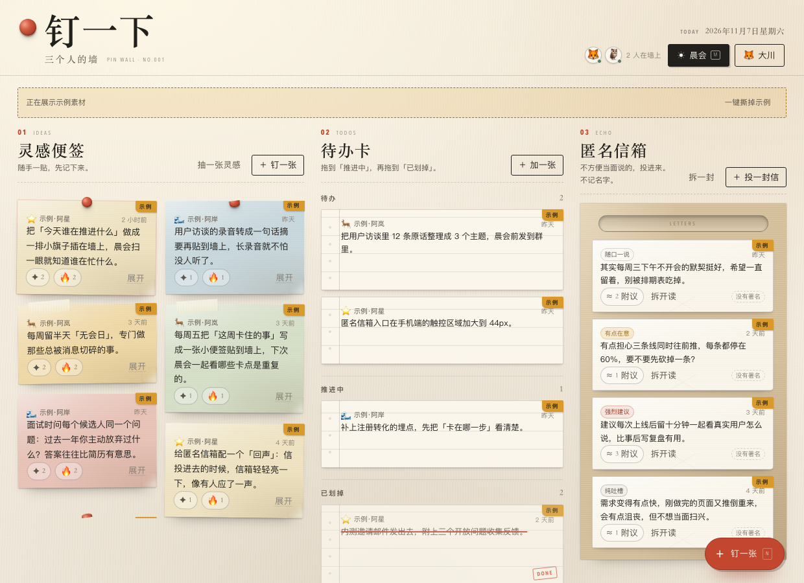
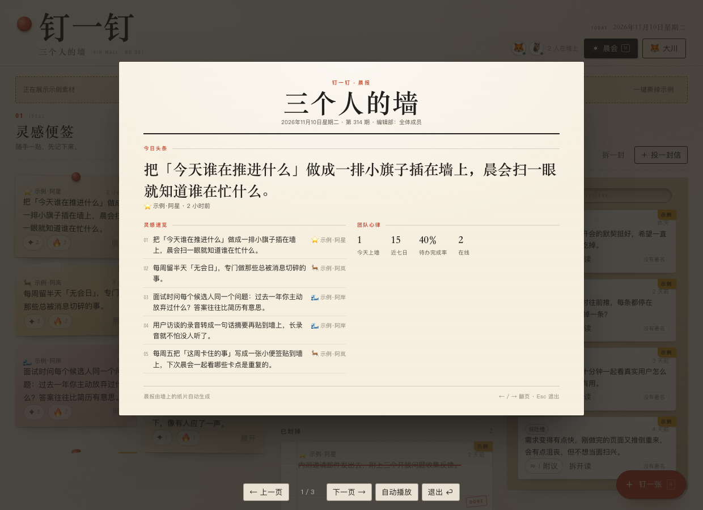
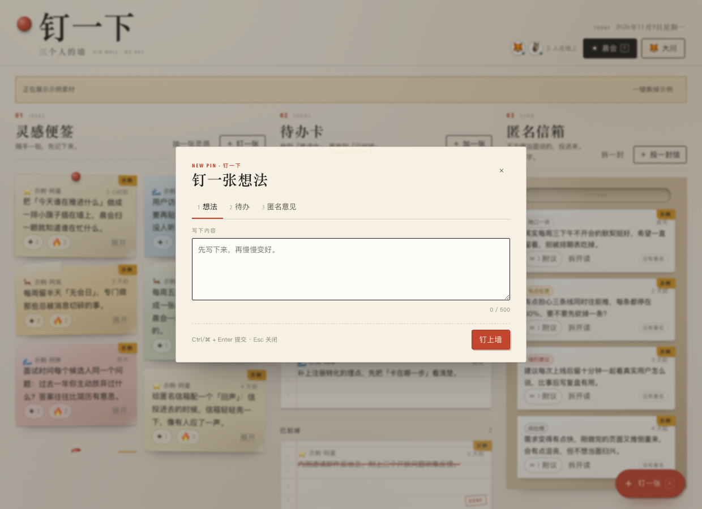
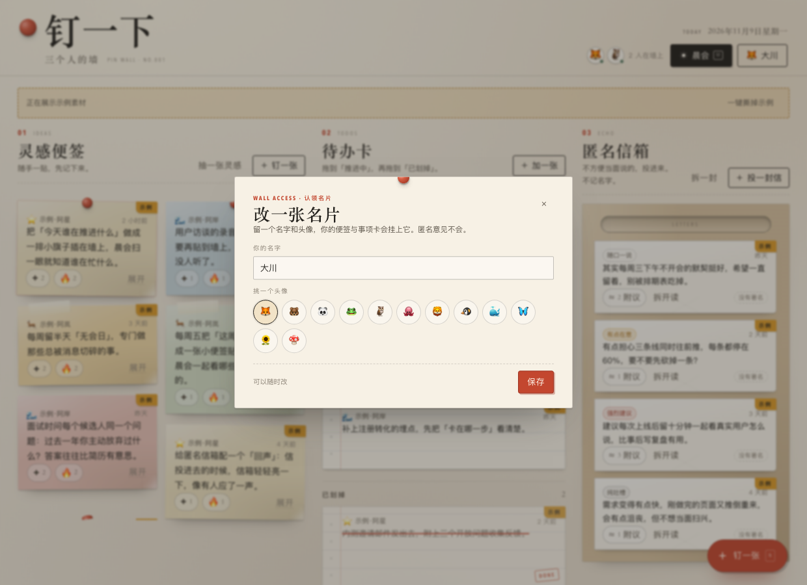
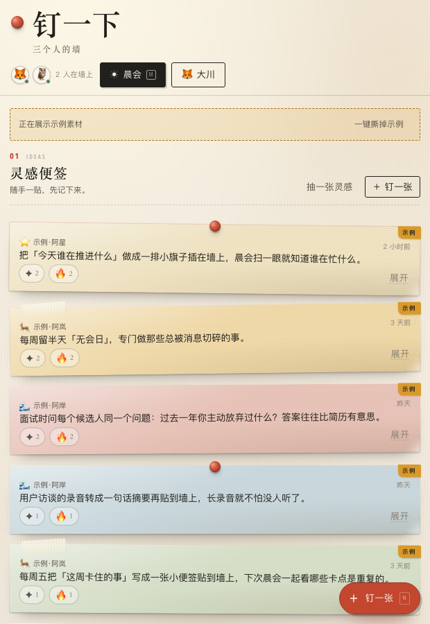
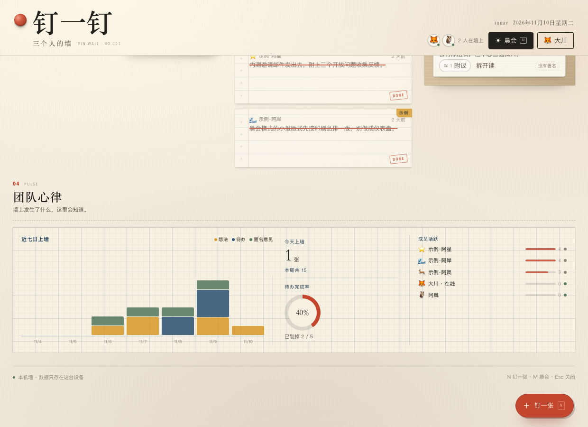
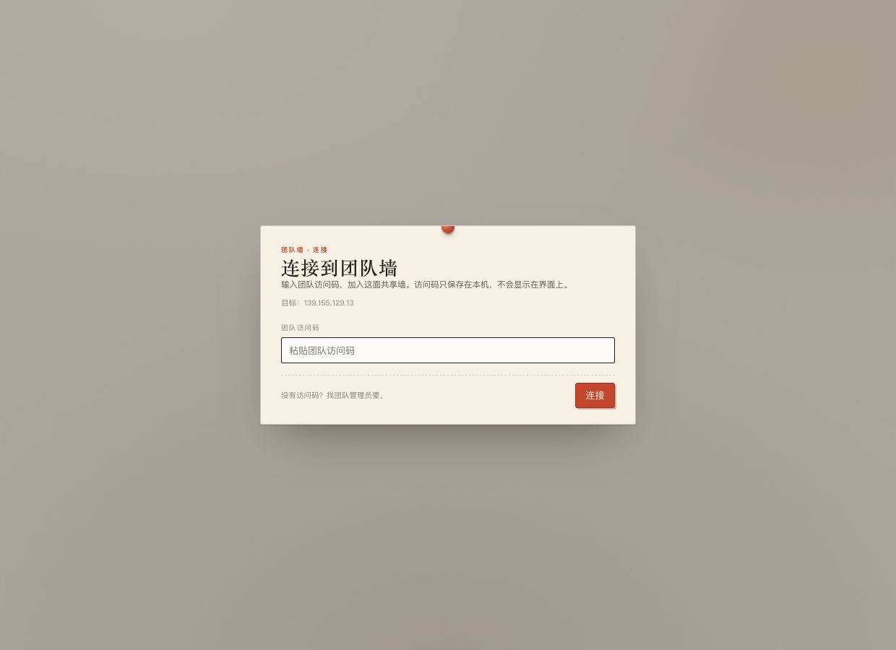

# Ding Wall · 钉一钉

**A warm, paper-like shared pinboard for small teams — as a DeepSeek Harness panel plugin.**

Ideas pinned as sticky notes, to-dos as index cards, anonymous feedback in a kraft-paper mailbox. Real-time sync for a small team, a hand-drawn “team pulse”, and a morning-paper mode for stand-ups.

The plugin connects to the team wall by default: enter the team access code once on first open. You can switch back to a local-only wall if you prefer.

**English** · [简体中文](README.md) · [Install with an agent](#install-with-an-agent) · [Manual install](#manual-install) · [Screenshots](#screenshots) · [Features](#features)



## Install with an agent

If you'd like an agent to install it, send the one-liner below to an AI agent that can work on your computer — DeepSeek Harness, Claude Code, Codex, or any agent with shell/file access:

### One-line install

> Install the DeepSeek Harness plugin at **https://github.com/Into-the-Numind/Ding-Wall** — clone it, add it as a local plugin bundle, tell me to fully restart DeepSeek Harness, then remind me to enter the team access code in the panel.

### What “done” looks like

- `dsh-ding-wall` appears as an installed plugin bundle and is enabled;
- after a **full app restart**, the sidebar shows a red pin **钉一钉**;
- on first open the panel asks for a **team access code**; after connecting, the footer shows “Shared wall”;
- after that, the first visit asks you to claim a team card and the team content appears;
- prefer a local wall? Set `serverUrl` to empty (see [Local-only wall](#local-only-wall-optional)).

> If the plugin manager in your DSH build cannot install a local directory, install it the same way you install any other local plugin bundle and point it at the cloned folder. If the icon does not appear, make sure you fully restarted Harness, not just reloaded the window.

## Screenshots

| Wall | Morning paper |
| --- | --- |
|  |  |

| Composer | Claim a card |
| --- | --- |
|  |  |

| Narrow panel | Team pulse |
| --- | --- |
|  |  |

| Connect to the team wall |
| --- |
|  |

## Features

- **Ideas as sticky notes** — one click to pin a thought; drag the wall into a calm paper workspace.
- **To-dos as index cards** — tomorrow / this week, with a satisfying DONE stamp.
- **Anonymous mailbox** — opinions are posted without an author; the server does not store who wrote them. Open a letter to delete it (team moderation; still no author stored).
- **Real-time team pulse** — presence, activity bars and a hand-drawn weekly rhythm.
- **Morning paper** — a broadsheet view for stand-ups, refreshed daily.
- **Warm paper aesthetic** — cream paper, Songti display type, pins, tape, rubber stamps and grain, restored from the original web design.
- **Team wall by default** — installation connects to the team wall; enter the access code once and it stays on this machine. A local-only wall is still available.
- **Bilingual UI** — 简体中文 / English, following the Harness locale.

## Requirements & compatibility

- DeepSeek Harness Desktop with the Web UI. Built and tested against the **DSH 0.2.1** series (November 2026).
- The plugin uses Harness client slot APIs (`sidebar.panellist`, main panel, locale, layout); these APIs are not frozen, so a future DSH major version may need small adjustments.
- No build step and no runtime npm dependencies: the client is a prebuilt ESM bundle, the host uses Node built-ins only.
- macOS / Windows / Linux wherever Harness Desktop runs.

## Manual install

1. Clone the repo somewhere permanent:

   ```bash
   git clone https://github.com/Into-the-Numind/Ding-Wall.git ~/dsh-plugins/dsh-ding-wall
   ```

   Windows (PowerShell):
   ```powershell
   git clone https://github.com/Into-the-Numind/Ding-Wall.git "$env:USERPROFILE\dsh-plugins\dsh-ding-wall"
   ```

2. In DeepSeek Harness, open **Plugins → Add plugin → local directory** and select the cloned folder (the one containing `package.json`). Enable the plugin.

3. **Fully quit and restart DeepSeek Harness.** (Host-side plugin code is loaded at startup; a page refresh only reloads the UI.)

4. Click the red pin **钉一钉** in the sidebar. On first open, enter the team access code, then claim your team card.

### Update

```bash
cd ~/dsh-plugins/dsh-ding-wall
git pull
```

Then fully restart Harness. If the panel still says “Local wall” after updating, reinstall this folder in Plugin Manager (so the new bundle defaults apply) or check whether your profile patch overrides `serverUrl`.

### Uninstall

Remove the plugin in Plugin Manager. Your wall data stays in `$DSH_HOME/ding-wall/`; delete that folder if you want a clean slate. (On macOS, `$DSH_HOME` is usually `~/.dsh`.)

## Data, privacy & network

- **Team wall by default:** wall data lives on the team's self-hosted shared service; team members share one wall.
- **Access code stays local:** after the first connection it is stored in `$DSH_HOME/ding-wall/connection.json` (mode 600), never sent to the browser and never committed to this repo.
- **Anonymous opinions:** no author ID is persisted for mailbox entries.
- **No telemetry, no analytics, no CDN calls.**
- The host plugin runs with your user permissions — like any Harness plugin, read the source before installing if you need to.
- In local-only mode (`serverUrl` empty), data stays in `$DSH_HOME/ding-wall/wall.json` on this machine.

## Team wall (default) and local-only mode

The plugin points at the team wall (`https://139.155.129.13`) by default. On first open, enter the team access code once — it is stored only on this machine (`$DSH_HOME/ding-wall/connection.json`, mode 600), never in the repo or the browser.

### Local-only wall (optional)

To use the wall on this computer only, without the team service, set `serverUrl` to empty in your profile patch:

```yaml
- id: ding-wall
  name: dsh-ding-wall
  config:
    serverUrl: ""
```

Data then lives in `$DSH_HOME/ding-wall/wall.json` and no network requests are made.

### Point at another wall service (advanced)

The wall server itself is not included in this repository; the plugin speaks a small JSON + SSE API. To use a self-hosted wall, override `serverUrl` / `serverToken` (and `serverCa` for self-signed deployments):

```yaml
- id: ding-wall
  name: dsh-ding-wall
  config:
    serverUrl: "https://your-wall.example.com"
    serverToken: "your-team-access-code"
    # serverCa: |
    #   -----BEGIN CERTIFICATE-----
    #   ...
    #   -----END CERTIFICATE-----
```

Teammates joining the default team wall only need to install/update the plugin, fully restart Harness, and enter the access code in the panel — no manual config editing.

## Keyboard shortcuts

| Shortcut | Action |
| --- | --- |
| `Ctrl`/`⌘` + `Enter` | Submit the open composer |
| `Esc` | Close composer / modal |

## Development

```bash
npm test
# or: node --test test/host.test.mjs test/client.test.mjs
```

No dependencies to install — tests run on plain Node.js 20+.

| Path | What it is |
| --- | --- |
| `package.json` | DSH bundle manifest (`dsh.bundle` + `dsh.client`) |
| `cordis.patch.yml` | Bundle patch: sidebar panel + main panel entries |
| `lib/index.js` | Host plugin: local store, shared-mode proxy, `/api/ding-wall/*` routes |
| `lib/store.js`, `lib/api.js`, `lib/sse.js` | Local API, atomic JSON persistence, SSE hub |
| `lib/proxy.js` | Shared-mode reverse proxy (including SSE, token and CA pinning) |
| `client.js` | Prebuilt client bundle: React panel, CSS, zh/en dictionaries |
| `test/` | Host and client contract tests |

## License

[MIT](LICENSE) © Into the Numind
