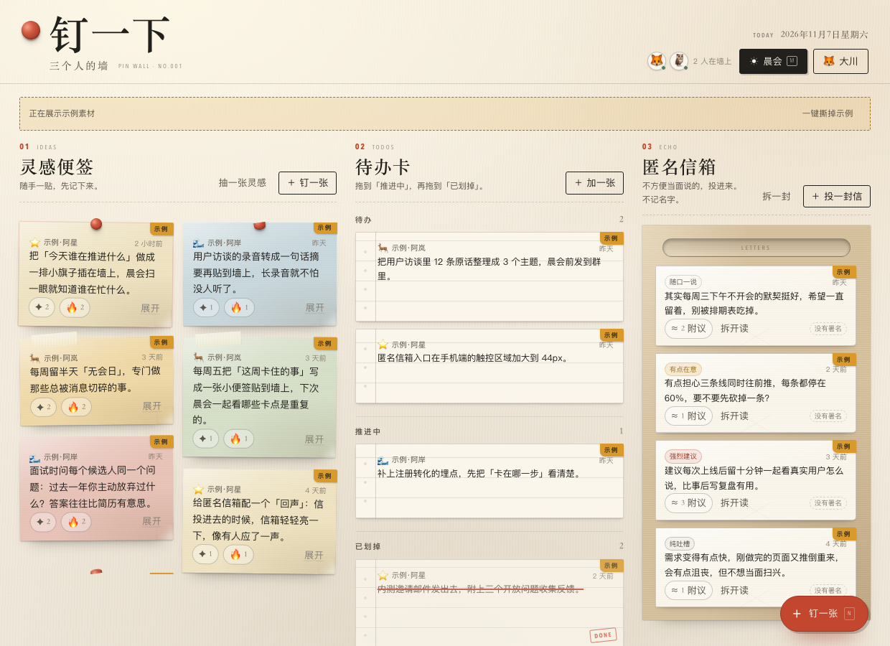
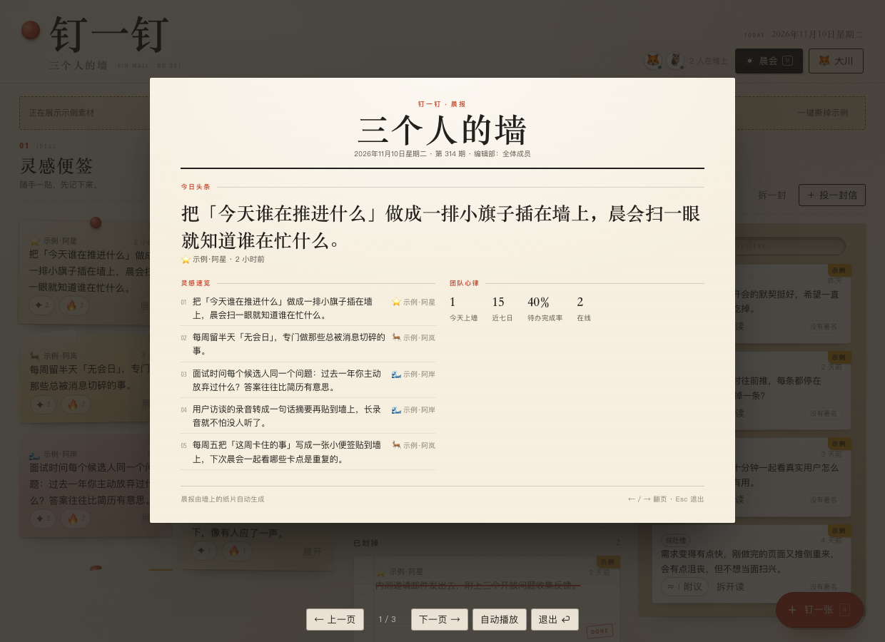
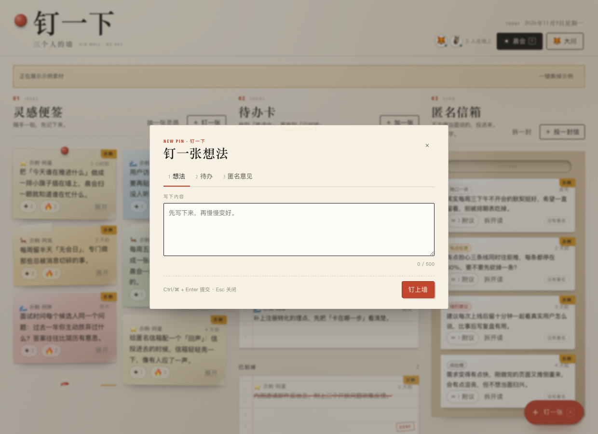
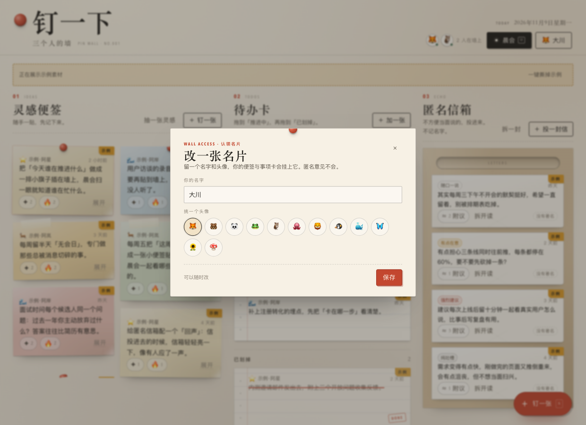
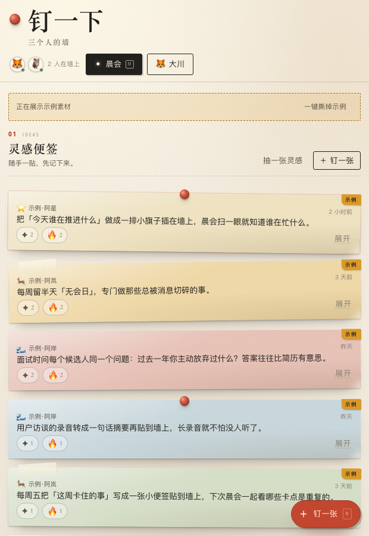
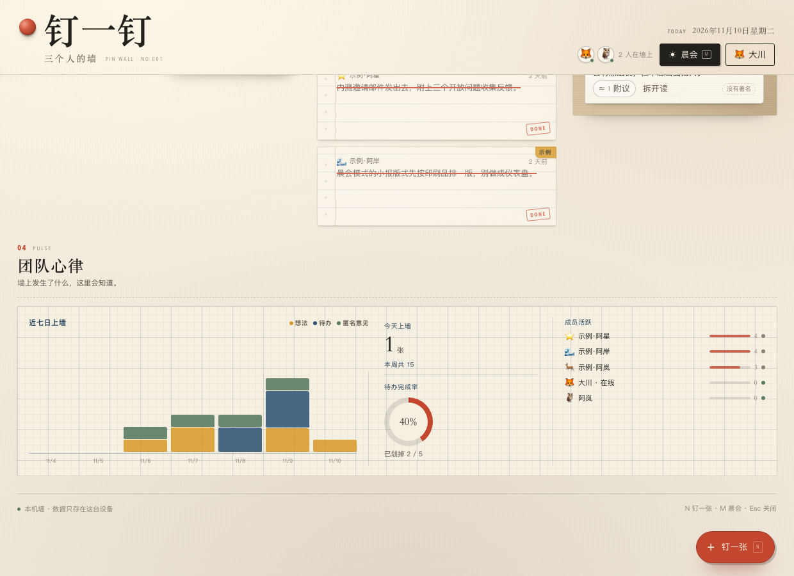
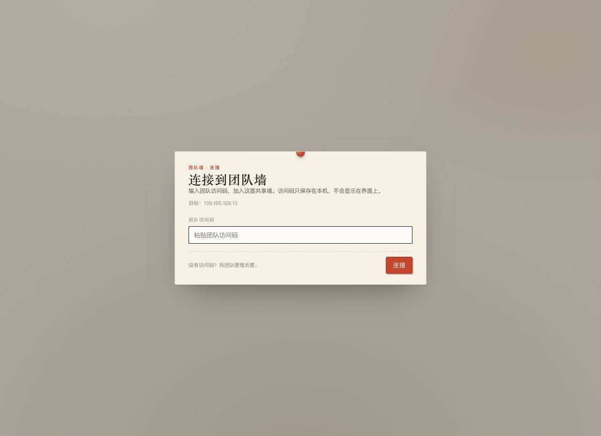

# 钉一钉 · Ding Wall

**给小团队的暖纸共享信息墙 —— 一个 DeepSeek Harness 面板插件。**

想法变成便签，待办变成索引卡，匿名意见投进牛皮纸信箱。小团队实时同步，手绘风格的「团队心跳」，还有适合站会的晨报模式。

安装后默认连接团队共享墙：首次打开面板时输入一次团队访问码即可开始使用；想单独使用也可以切回本机墙。

[English](README.en.md) · **简体中文** · [让 Agent 安装](#让-agent-安装) · [手动安装](#手动安装) · [截图](#截图) · [功能](#功能)



## 让 Agent 安装

如果你想让 Agent 帮你安装，把下面这句话发给一个能在你电脑上执行操作的 AI Agent（DeepSeek Harness、Claude Code、Codex，或任何有 shell / 文件权限的 Agent）：

### 一句话安装

> 安装 DeepSeek Harness 插件 **https://github.com/Into-the-Numind/Ding-Wall** —— 克隆到固定目录、作为本地插件包安装，提醒我完全重启 DeepSeek Harness，然后提醒我在面板里输入团队访问码。

### 怎么算装好了

- `dsh-ding-wall` 出现在插件列表中，且处于启用状态；
- **完全重启应用**后，侧栏出现红色图钉「钉一钉」；
- 点开面板，首次会要求输入**团队访问码**，连接成功后底部显示「共享墙」；
- 连接成功后首次进入会要求认领一张团队名片，之后就能看到团队墙内容；
- 想只用本机墙：把 `serverUrl` 设为空（见[本机墙（可选）](#本机墙可选)）。

> 如果你的 DSH 版本插件管理器不支持安装本地目录，就用安装其他本地插件包的方式安装这个文件夹。如果图钉没出现，先确认是**完全重启**了 Harness，而不是只刷新了窗口。

## 截图

| 信息墙 | 晨报模式 |
| --- | --- |
|  |  |

| 钉一张 | 认领名片 |
| --- | --- |
|  |  |

| 窄面板 | 团队心跳 |
| --- | --- |
|  |  |

| 首次连接团队墙 |
| --- |
|  |

## 功能

- **灵感便签**：点一下就能把想法钉上墙，便签可以拖动、撕下。
- **待办索引卡**：明天 / 这周两栏，完成时盖一枚「完成」印章。
- **匿名信箱**：匿名意见不记录作者，服务端不会存是谁写的。
- **团队心跳**：在线状态、活动条、手绘风格的一周节奏。
- **晨报模式**：适合站会的报纸版面，每天刷新。
- **暖纸视觉**：奶油纸色、宋体标题、图钉、胶带、橡皮章和纸纹，来自最初的网页版设计。
- **默认连团队墙**：安装后连接团队的共享墙，输入一次访问码即可；访问码只存在本机。想单独使用可切换本机墙模式。
- **中英双语**：跟随 Harness 的语言设置。

## 环境要求与兼容性

- DeepSeek Harness Desktop 的 Web UI。基于 **DSH 0.2.1** 系列（2026 年 11 月）开发与测试。
- 插件使用了 Harness 的客户端插槽 API（`sidebar.panellist`、主面板、locale、layout）；这些 API 尚未冻结，未来 DSH 大版本可能需要小幅适配。
- 无需构建、运行时无 npm 依赖：客户端是预构建 ESM bundle，宿主侧只用 Node 内置模块。
- 支持 Harness Desktop 所在的 macOS / Windows / Linux。

## 手动安装

1. 克隆到一个固定目录：

   ```bash
   git clone https://github.com/Into-the-Numind/Ding-Wall.git ~/dsh-plugins/dsh-ding-wall
   ```

   Windows（PowerShell）：
   ```powershell
   git clone https://github.com/Into-the-Numind/Ding-Wall.git "$env:USERPROFILE\dsh-plugins\dsh-ding-wall"
   ```

2. 打开 DeepSeek Harness 的**插件 → 添加插件 → 本地目录**，选择克隆下来的文件夹（包含 `package.json` 的那一层），启用插件。

3. **完全退出并重启 DeepSeek Harness。**（宿主侧插件代码在启动时加载；刷新页面只会重载 UI。）

4. 点击侧栏红色图钉「钉一钉」。首次打开时输入团队访问码，连接成功后认领你的团队名片。

### 更新

```bash
cd ~/dsh-plugins/dsh-ding-wall
git pull
```

然后完全重启 Harness。如果更新后插件仍显示「本机墙」，在插件管理器里重新安装一次该目录（确保新的 bundle 默认配置生效），或检查 profile 补丁里有没有覆盖 `serverUrl`。

### 卸载

在插件管理器中移除插件。墙的数据仍保留在 `$DSH_HOME/ding-wall/`；如需彻底清空，删除该目录即可。（macOS 上 `$DSH_HOME` 一般是 `~/.dsh`。）

## 数据、隐私与网络

- **默认连接团队墙**：墙的数据存储在团队自托管的共享服务上，团队成员共享同一面墙。
- **访问码只存在本机**：首次连接后保存在 `$DSH_HOME/ding-wall/connection.json`（权限 600），不会下发浏览器，也不会写进仓库。
- **匿名意见**：信箱条目不会持久化任何作者标识。
- **无遥测、无统计、无 CDN 请求。**
- 宿主插件以你的用户权限运行——和任何 Harness 插件一样，介意的话安装前先读源码。
- 本机墙模式（把 `serverUrl` 设为空）下，数据只存在本机 `$DSH_HOME/ding-wall/wall.json`。

## 团队墙（默认）与本机墙（可选）

安装后默认连接团队的共享墙：`https://139.155.129.13`。首次打开面板会要求输入**团队访问码**，输入一次后只保存在本机（`$DSH_HOME/ding-wall/connection.json`，权限 600），不会写进仓库或浏览器。

### 本机墙（可选）

如果只想在这台电脑上单独使用，不连接团队服务，在 profile 补丁里把 `serverUrl` 设为空：

```yaml
- id: ding-wall
  name: dsh-ding-wall
  config:
    serverUrl: ""
```

这样数据存在本机 `$DSH_HOME/ding-wall/wall.json`，不联网。

### 换一个墙服务（高级）

团队墙服务端不在本仓库内；插件只依赖一套很小的 JSON + SSE 接口。要连接其它自建墙，覆盖 `serverUrl` / `serverToken`（自签证书再加 `serverCa`）：

```yaml
- id: ding-wall
  name: dsh-ding-wall
  config:
    serverUrl: "https://your-wall.example.com"
    serverToken: "your-team-access-code"
    # serverCa: |
    #   -----BEGIN CERTIFICATE-----
    #   ...
    #   -----END CERTIFICATE-----
```

如果只是队友要加入默认团队墙：安装/更新插件 → 完全重启 Harness → 在面板里输入团队访问码即可，不需要手动改配置。

## 快捷键

| 快捷键 | 操作 |
| --- | --- |
| `Ctrl`/`⌘` + `Enter` | 提交当前弹层 |
| `Esc` | 关闭弹层 |

## 开发

```bash
npm test
# 或者：node --test test/host.test.mjs test/client.test.mjs
```

无需安装依赖，测试直接跑在 Node.js 20+。

| 路径 | 说明 |
| --- | --- |
| `package.json` | DSH 插件包清单（`dsh.bundle` + `dsh.client`） |
| `cordis.patch.yml` | 插件包补丁：侧栏入口 + 主面板 |
| `lib/index.js` | 宿主插件：本地存储、共享模式代理、`/api/ding-wall/*` 路由 |
| `lib/store.js`、`lib/api.js`、`lib/sse.js` | 本地 API、原子 JSON 落盘、SSE 广播 |
| `lib/proxy.js` | 共享模式反向代理（含 SSE、访问码与 CA 固定） |
| `client.js` | 预构建客户端 bundle：React 面板、样式、中英词典 |
| `test/` | 宿主与客户端契约测试 |

## 许可证

[MIT](LICENSE) © Into the Numind
